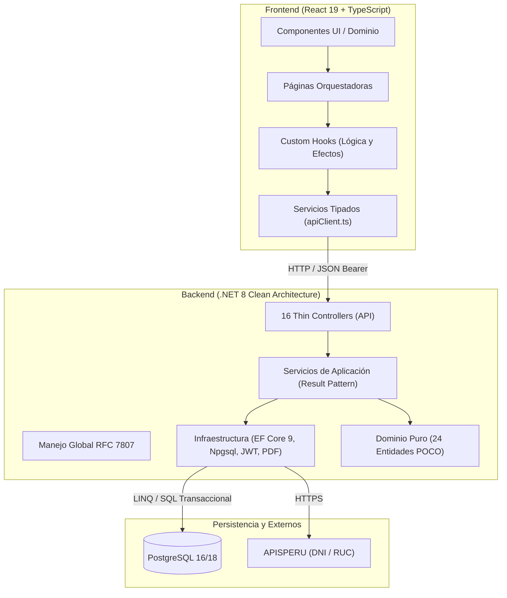

# Documento de Contexto Integral del Proyecto — GirasolesRes

Este documento proporciona una transferencia de conocimiento técnica completa, exhaustiva y estructurada del sistema **GirasolesRes**. Está diseñado para que cualquier ingeniero de software o agente de inteligencia artificial (como Claude) pueda comprender de inmediato el propósito, la arquitectura, el estado actual del código, las convenciones y los próximos pasos sin necesidad de inducción previa.

---

## 1. RESUMEN GENERAL

### 1.1 ¿Qué es el proyecto y para qué sirve?
**GirasolesRes** es una plataforma web transaccional fullstack para la gestión integral gastronómica, punto de venta (POS) y control operativo del restaurante **"Girasoles"**.
El sistema digitaliza y sincroniza en tiempo real el ciclo operativo de un restaurante:
1. **Salón (Mozos):** Control visual del plano de mesas y captura ergonómica de comandas táctiles con personalización de menús y notas de cocina.
2. **Cocina (Cocineros):** Pantalla KDS (*Kitchen Display System*) con orden cronológico, semáforo visual de demoras y avisos sonoros de despacho.
3. **Caja y Cobranzas (Cajeros):** Apertura de turno, liquidación multicanal de pedidos (Efectivo con cálculo de vuelto, Yape, Plin, Tarjeta), validación fiscal peruana en línea (DNI en RENIEC, RUC en SUNAT), emisión vectorial en memoria de comprobantes PDF y arqueo físico con control de faltantes/sobrantes.
4. **Gerencia y Auditoría (Administradores):** Reportes de cuadratura financiera, métricas de mozos, ranking de platos más vendidos, auditoría de eventos y dashboard con KPIs en tiempo real.

### 1.2 Roles de Usuario (RBAC)
* **`Administrador`:** Control total del sistema, configuración de carta, menú del día, reportes gerenciales, gestión de usuarios y consulta de auditoría histórica.
* **`Cajero`:** Apertura de caja, cobro de pedidos en mesa y para llevar, emisión/anulación de comprobantes, arqueo físico de efectivo y cierre de turno con generación de acta oficial.
* **`Mozo`:** Visualización del salón, toma de pedidos en mesa, asignación de partes en menús completos y consulta de estado de preparación.
* **`Cocinero`:** Visualización exclusiva de la pantalla de cocina (KDS), transición de comandas (En Preparación $\rightarrow$ Lista) y notificación sonora a salón.

### 1.3 Estado Actual del Proyecto
* **Fase:** Pre-producción / *Release Candidate* (v1.0.0).
* **Alcance Funcional:** Los 11 módulos operativos principales (Casos de Uso CUS01 al CUS15) están 100% implementados y conectados a PostgreSQL.
* **Calidad y Pruebas:** Suite automatizada de **96 pruebas unitarias e integración aprobadas al 100%** en xUnit (.NET 8).
* **Frontend:** Compilación estricta sin errores ni advertencias (`tsc -b && vite build`) bajo Arquitectura Basada en Componentes y estándar WCAG AA de accesibilidad visual.
* **DevOps:** Pipeline de Integración Continua (CI) en GitHub Actions (`.github/workflows/ci.yml`) con ejecución automatizada de pruebas y build en cada push/PR a `main`.

---

## 2. STACK Y ENTORNO

### 2.1 Tecnologías y Versiones

| Capa | Tecnología | Versión | Propósito / Características |
| :--- | :--- | :--- | :--- |
| **Backend Runtime** | .NET LTS | `8.0` | C# 12, pattern matching, records y directivas de lenguaje modernas. |
| **Framework Web** | ASP.NET Core Web API | `8.0` | API REST con Thin Controllers, RFC 7807 (*ProblemDetails*) y Swagger/OpenAPI. |
| **ORM & Acceso a Datos** | Entity Framework Core & Npgsql | `9.0.2` | Mapeo relacional, consultas LINQ tipadas y control de concurrencia. |
| **Base de Datos** | PostgreSQL | `16 / 18` | Base relacional con esquemas normalizados, índices y auditoría transaccional. |
| **Seguridad Criptográfica** | PBKDF2 (HMAC-SHA256) | `9.0.0` | Hashing con 100,000 iteraciones, salt criptográfico de 128 bits y clave de 256 bits. |
| **Autenticación** | JWT Bearer (HS256) | `8.2.1` | Tokens firmados con revocación en base de datos (`TokenRevocado`). |
| **Generador PDF** | `PdfCanvasBuilder` | Nativo C# | Motor vectorial de bajo nivel en memoria sin librerías de terceros (tickets y actas). |
| **Frontend Framework** | React | `19.2.8` | UI declarativa con Component-Based Architecture y Custom Hooks. |
| **Lenguaje Frontend** | TypeScript | `6.0.2` | Tipado estricto con `verbatimModuleSyntax: true` y zero `any`. |
| **Empaquetador (Bundler)**| Vite | `8.3.0` | Build nativo ultrarrápido con plugin `@tailwindcss/vite`. |
| **Framework CSS** | Tailwind CSS | `4.3.3` | Estilos de utilidad modernos con variables `@theme` nativas. |
| **Tipografía** | Inter Variable | `5.3.0` | `@fontsource-variable/inter` empaquetado localmente para independencia de red. |
| **Iconografía** | Lucide React | `1.57.0` | Set iconográfico estándar optimizado para React. |
| **Testing Backend** | xUnit & Moq | `2.9.2` | Pruebas unitarias de servicios de aplicación, dominio y mocks de persistencia. |

### 2.2 Requisitos Previos para Desarrollo
* **.NET SDK 8.0+** instalado y accesible en PATH (`dotnet --version`).
* **Node.js 20+ LTS** y npm 10+ (`node -v`, `npm -v`).
* **PostgreSQL 16 o 18** (local en puerto 5432) o **Docker Desktop**.

### 2.3 Instrucciones de Instalación y Ejecución

#### Opción A: Base de Datos con Docker Compose
```bash
# 1. Levantar contenedor de PostgreSQL con inicialización automática
docker compose up -d

# 2. Verificar que el contenedor esté saludable en el puerto 5432
docker ps
```

#### Opción B: Inicialización Manual de PostgreSQL
Si se utiliza una instancia local de PostgreSQL, ejecutar los scripts DDL en orden:
```bash
# Conectarse a postgres y crear la base de datos
psql -U postgres -c "CREATE DATABASE girasoles_db;"
psql -U postgres -d girasoles_db -f database/init_girasoles_db.sql
```

#### Ejecución del Backend (.NET 8 Web API)
```bash
# Restaurar dependencias
dotnet restore GirasolesRes.sln

# Ejecutar el proyecto API
dotnet run --project backend/GirasolesRes.API/GirasolesRes.API.csproj --launch-profile http
# API disponible en: http://localhost:5000 (Swagger en http://localhost:5000/swagger)
```

#### Ejecución del Frontend (React + Vite)
```bash
cd frontend
npm install
npm run dev
# Frontend disponible en: http://localhost:5173
```

#### Ejecución de Pruebas Automatizadas
```bash
# Pruebas unitarias y de integración de backend (.NET)
dotnet test GirasolesRes.sln --configuration Release

# Compilación estricta y typecheck del frontend
npm --prefix frontend run build
```

### 2.4 Variables de Entorno y Configuración (Plantilla Segura)

#### Backend: `backend/GirasolesRes.API/appsettings.json`
```json
{
  "ConnectionStrings": {
    "DefaultConnection": "Host=localhost;Port=5432;Database=girasoles_db;Username=postgres;Password=<TU_CONTRASENA>"
  },
  "Jwt": {
    "SecretKey": "<CLAVE_SECRETA_CRIPTO_MINIMO_32_CARACTERES>",
    "Issuer": "GirasolesRes",
    "Audience": "GirasolesResApp",
    "ExpiryMinutes": "30"
  },
  "Logging": {
    "LogLevel": {
      "Default": "Information",
      "Microsoft.AspNetCore": "Warning",
      "Microsoft.EntityFrameworkCore.Database.Command": "Information"
    }
  },
  "ApisPeru": {
    "BaseUrl": "https://dniruc.apisperu.com/api/v1",
    "Token": "<TOKEN_DE_SERVICIO_APISPERU>"
  },
  "AllowedHosts": "*"
}
```

#### Frontend: `frontend/.env` (Opcional, con defaults configurados en código)
```env
VITE_API_URL=http://localhost:5000/api
```

---

## 3. ESTRUCTURA DEL PROYECTO

```text
GirasolesRes/
├── .github/workflows/          # Integración Continua (GitHub Actions CI: ci.yml)
├── AGENTS.md                   # Gobernanza de arquitectura, reglas de IA y commits
├── CHANGELOG.md                # Historial de versiones y trazabilidad SemVer
├── README.md                   # Documentación de inducción general
├── docker-compose.yml          # Servicio de PostgreSQL 16 con init SQL montado
├── GirasolesRes.sln            # Solución estándar .NET 8
├── database/                   # DDL de base de datos y respaldos
│   ├── init_girasoles_db.sql       # Script oficial de inicialización y datos base
│   └── backup_completo_*.sql       # Dumps completos para restauración rápida
├── docs/                       # Documentación formal de arquitectura y estándares
│   ├── DOCUMENTO_TECNICO_*.md      # Especificación IEEE / ISO 25010 del sistema
│   └── database/DATA_DICTIONARY.md # Diccionario de datos de las 24 tablas
├── backend/                    # Backend ASP.NET Core 8 (Clean Architecture)
│   ├── GirasolesRes.Domain/          # Capa Núcleo: Entidades POCO (24) y Enums puros
│   │   ├── Entities/                 # Usuario, Caja, Venta, Comprobante, Pedido, Mesa...
│   │   └── Enums/                    # RolUsuario, EstadoPedido, TipoComprobante...
│   ├── GirasolesRes.Application/     # Casos de uso de negocio y contratos
│   │   ├── Common/                   # Result<T>, TimeZoneHelper (Perú GMT-5), Exceptions
│   │   ├── DTOs/                     # DTOs de entrada y salida fuertemente tipados
│   │   ├── Interfaces/               # Contratos de persistencia y servicios
│   │   └── Services/                 # Implementación de casos de uso (Caja, Cobro, Pedido...)
│   ├── GirasolesRes.Infrastructure/  # Implementación técnica y adaptadores
│   │   ├── Data/                     # GirasolesDbContext (EF Core 9, mappings snake_case)
│   │   ├── Repositories/             # Repositorios concretos con Npgsql
│   │   ├── Security/                 # Generación JWT, PBKDF2 PasswordHasher
│   │   └── Services/                 # PdfCanvasBuilder, ApisPeruClient, BackgroundServices
│   └── GirasolesRes.API/             # Punto de entrada HTTP (Thin Controllers)
│       ├── Controllers/              # 16 Controladores REST delgados
│       ├── Middleware/               # Manejo global de excepciones (RFC 7807)
│       └── Program.cs                # Inyección de dependencias, CORS, JWT Auth
├── frontend/                   # Frontend React 19 + TypeScript + Vite + Tailwind 4
│   ├── src/
│   │   ├── components/               # Arquitectura Basada en Componentes
│   │   │   ├── ui/                   # UI Primitiva agnóstica (Button, ActionButton, Modal...)
│   │   │   ├── layout/               # Marco estructural (Header, Sidebar, PageHeader...)
│   │   │   ├── mesas/                # Dominio Salón (MesaCard, MesaFormModal...)
│   │   │   ├── cocina/               # Dominio KDS (ComandaCard, CocinaResumenBar...)
│   │   │   ├── caja/                 # Dominio Caja (CerrarCajaModal, AbrirCajaModal...)
│   │   │   ├── cobros/               # Dominio Cobranzas (CobroModal, TicketModal...)
│   │   │   ├── pedidos/              # Dominio Toma de Pedidos (MenuItemCard, Modales...)
│   │   │   ├── menu-dia/             # Dominio Menú del Día (ArmarMenuCompletoModal...)
│   │   │   ├── productos/            # Dominio Carta (ProductFormModal, ConfirmModal...)
│   │   │   ├── usuarios/             # Dominio Seguridad (UserFormModal, PasswordModal...)
│   │   │   ├── ventas/               # Dominio Ventas (VentaDetalleModal, AnularModal...)
│   │   │   ├── reportes/             # Dominio Reportes (ReportKpiCard...)
│   │   │   └── dashboard/            # Vistas diferenciadas por rol (Admin, Cajero, Mozo...)
│   │   ├── layouts/                  # Plantillas maestras (MainLayout, AuthLayout 60/40)
│   │   ├── pages/                    # 16 Vistas contenedoras orquestadoras
│   │   ├── hooks/                    # Custom Hooks desacoplados de ciclo de vida
│   │   ├── services/                 # apiClient.ts nativo y APIs tipadas
│   │   ├── types/                    # Contratos e interfaces TypeScript
│   │   └── utils/                    # Utilidades de formato monetario y fechas
│   ├── package.json                  # Dependencias y scripts
│   └── vite.config.ts                # Configuración de Vite con Tailwind 4
└── tests/                      # Suite de Pruebas Automatizadas
    └── GirasolesRes.Tests/           # 96 Pruebas xUnit (Dominio, Aplicación, Result Pattern)
```

---

## 4. ARQUITECTURA Y FUNCIONAMIENTO

### 4.1 Principios Arquitectónicos
El sistema aplica una separación estricta de responsabilidades:
1. **Clean Architecture (Backend):**
   * Las capas internas (`Domain`, `Application`) no dependen de frameworks, Entity Framework ni bases de datos.
   * `Application` define contratos (`Interfaces`) que son implementados en `Infrastructure`.
   * Los controladores de `GirasolesRes.API` son delgados (*Thin Controllers*): reciben requests, validan ModelState, delegan al servicio de aplicación y devuelven el resultado HTTP con códigos estándar (`200 OK`, `201 Created`, `400 BadRequest`, `404 NotFound`).
   * **Patrón Result:** Todo servicio de aplicación devuelve instancias de `Result` o `Result<T>` para el manejo seguro de errores de negocio sin lanzar excepciones innecesarias.
2. **Component-Based Architecture (Frontend):**
   * **UI Primitiva (`components/ui/`):** Componentes presentacionales puros agnósticos al negocio (`Button`, `ActionButton`, `ModalWrapper`, `StatusBadge`, `StatCard`, `InputField`).
   * **Componentes de Dominio (`components/<dominio>/`):** Desacoplan el renderizado visual de cada módulo de restaurante (`MesaCard`, `ComandaCard`, `CobroModal`, etc.).
   * **Páginas Orquestadoras (`pages/*.tsx`):** Las vistas no contienen HTML masivo ni lógica HTTP dispersa; consumen *custom hooks* y componen los bloques de dominio.
   * **Cliente HTTP Nativo (`services/apiClient.ts`):** Basado en `window.fetch` tipado con interceptores para JWT y manejo de RFC 7807 (*ProblemDetails*).

### 4.2 Diagrama de Flujo General



### 4.3 Flujo Crítico de Liquidación y Cobro (CUS11)
El cobro de pedidos es una de las operaciones compuestas más sensibles del restaurante y se ejecuta de forma atómica:
1. El cajero selecciona un pedido en estado `Listo` o `Servido` desde el panel de Cobros.
2. Si el comprobante es **Boleta** o **Factura**, se valida en tiempo real el DNI (RENIEC) o RUC (SUNAT). Para montos $\ge$ S/ 700.00, la identificación del cliente es fiscalmente obligatoria.
3. El servicio `CobroService.ProcesarCobroAsync`:
   * Verifica la unicidad del `solicitudId` para garantizar **idempotencia** ante reintentos de red.
   * Valida que la caja del turno esté abierta y pertenezca al día operativo actual.
   * Actualiza el estado del pedido a `Pagado`.
   * Si el pedido es de salón, libera la mesa física asociada cambiando su estado a `Libre`.
   * Registra la transacción de `Venta` vinculada a la caja abierta.
   * Genera el registro de `Comprobante` (Ticket, Boleta o Factura) con correlativo secuencial.
   * Genera en memoria el PDF vectorial de comprobante térmico (80 mm) mediante `PdfCanvasBuilder`.
   * Registra la auditoría en `AuditoriaCobro`.

---

## 5. LO QUE YA ESTÁ HECHO

### 5.1 Módulos Funcionales Completados (CUS01 al CUS15)
1. **Seguridad y Accesos (CUS01, CUS01.1, CUS01.2):** Login con diseño corporativo 60/40, JWT Bearer, recuperación por código temporal de un solo uso, caducidad por inactividad a los 30 min y revocación de tokens.
2. **Salón y Mesas (CUS02):** Grilla interactiva de mesas con estados dinámicos (Libre, Ocupada, Reservada) y bloqueo de eliminación si tiene comensales o pedidos activos.
3. **Carta y Productos (CUS04):** Categorías gastronómicas, precios unitarios, disponibilidad y diferenciación de productos a la carta vs. componentes de menú.
4. **Menú del Día y Menús Completos (CUS04.1, CUS05):** Parametrización diaria de menús compuestos con partes configurables (Entrada, Segundo, Refresco) y control de platos agotados.
5. **Toma de Pedidos en Salón (CUS07):** Selector táctil interactivo con asistente para completar partes de menús del día, notas para cocina y cálculo automático de totales.
6. **Pedidos Para Llevar (CUS08):** Toma ágil de pedidos en mostrador sin ocupar mesa física, con generación de comanda de despacho.
7. **Monitoreo de Pedidos (CUS06):** Tabla de control en tiempo real con transiciones cronológicas (Pendiente, En Preparación, Listo, Pagado, Anulado) y motivos de cancelación.
8. **KDS de Cocina (CUS09, CUS10):** Pantalla digital de comandas cronológicas con semáforo de demoras (verde $<15$ min, ámbar $15-30$ min, rojo $>30$ min) y alertas sonoras.
9. **Caja y Cobranzas (CUS11):** Cobro multicanal (Efectivo con cálculo de vuelto, Yape, Plin, Tarjetas), validación fiscal RENIEC/SUNAT y emisión vectorial de comprobantes térmicos en PDF.
10. **Arqueo y Cierre de Caja (CUS13):** Apertura de turno con monto inicial, arqueo físico con desglose de denominaciones peruanas (billetes y monedas), cálculo de cuadre (cuadra, sobrante, faltante) y acta oficial de cierre en PDF A4.
11. **Auditoría, Reportes y Dashboard (CUS12, CUS14, CUS15):** Historial y anulación de ventas con motivo obligatorio, reportes gerenciales (ranking de platos, métricas de mozos) y dashboard en tiempo real adaptado al rol del usuario.

### 5.2 Estándares Visuales y de Calidad Alcanzados
* **Tipografía Unificada:** Adopción de `Inter Variable` en todo el sistema frontend, eliminando peticiones externas a Google Fonts.
* **Accesibilidad WCAG AA:**
  * Botones principales ajustados a `#C74E00` (ratio **4.65:1** con texto blanco).
  * Textos naranjas sobre fondo claro ajustados a `#B84500` (ratio **5.40:1** sobre blanco y **5.06:1** sobre crema `#FAF7F4`).
  * Tamaño mínimo de texto estandarizado a 12 px (`text-xs`).
* **Suite de Pruebas:** 96 pruebas unitarias y de integración pasando al 100% en Release.
* **Integración Continua:** GitHub Actions configurado y en verde en la rama `main`.

---

## 6. LO QUE ESTÁ EN PROGRESO O PENDIENTE

1. **Integración con Facturador SUNAT / PSE Oficial:**
   * *Estado actual:* El sistema valida RUC y DNI en tiempo real mediante APISPERU y genera comprobantes PDF válidos para control interno y tributario.
   * *Pendiente:* Generación del XML UBL 2.1 con firma digital X.509 y envío a la API de SUNAT para recepción de CDR (*Constancia de Recepción*).
2. **Sincronización en Tiempo Real con WebSockets / SignalR:**
   * *Estado actual:* La pantalla KDS y el monitor de pedidos utilizan polling periódico optimizado.
   * *Pendiente:* Migrar a un hub de SignalR en ASP.NET Core para notificaciones push instantáneas sin peticiones HTTP repetitivas.
3. **Modo Offline / PWA para Mozos:**
   * *Pendiente:* Implementar Service Worker y almacenamiento local (IndexedDB) para permitir la toma de comandas en tablets en zonas del salón con baja cobertura Wi-Fi.
4. **Optimización de Code-Splitting en Frontend:**
   * *Pendiente:* Incorporar `React.lazy()` y `Suspense` en `App.tsx` para dividir el bundle principal de JavaScript (actualmente 892 kB) en chunks por ruta.

---

## 7. PROBLEMAS Y BLOQUEOS ACTUALES

* **Errores de Compilación o Pruebas:** **0 errores.** Tanto el backend (`dotnet build`, `dotnet test`) como el frontend (`npm run build`) compilan limpiamente.
* **Archivo de Bloqueo de Microsoft Word:** En el directorio `docs/` existe un archivo temporal `docs/~$CUMENTO_TECNICO_GIRASOLESRES_IEEE.docx` generado al tener abierto el documento en Word. **Regla estricta:** Nunca incluir archivos `~$*.docx` en `git add` ni forzar su rastreo.
* **Advertencia de Chunk Size en Vite:** Vite emite una sugerencia (*warning*) informando que el archivo `dist/assets/index-*.js` supera los 500 kB (892 kB). No bloquea la ejecución ni el build, pero amerita la implementación de `React.lazy()`.

---

## 8. CAMBIOS RECIENTES

Historial de los últimos commits integrados en la rama principal `main`:

* **`5b040c5`** - `style(frontend): ampliar ancho de columna cajero y preservar tooltip en historial de ventas`: Ajuste a `w-36` con tooltip completo en [VentasPage.tsx](file:///e:/Downloads/GirasolesRes/frontend/src/pages/VentasPage.tsx).
* **`ff5bfa2`** - `style(frontend): optimizar contraste de textos naranjas a #B84500 para cumplir wcag aa sobre blanco y crema`: Migración de 226 ocurrencias de `text-[#D35400]` a `text-[#B84500]` para garantizar ratios $> 5:1$.
* **`b30da82`** - `style(frontend): evitar particion de montos y diferencias en tabla de historial de cierres`: Incorporación de `whitespace-nowrap` y contenedor con desplazamiento horizontal en [HistorialCierresPage.tsx](file:///e:/Downloads/GirasolesRes/frontend/src/pages/HistorialCierresPage.tsx).
* **`ed76902`** - `style(frontend): optimizar etiqueta de estado de caja para evitar truncamiento en sidebar`: Badge "Cerrada" estilizado y padding optimizado en [Sidebar.tsx](file:///e:/Downloads/GirasolesRes/frontend/src/components/layout/Sidebar.tsx).
* **`8399559`** - `style(frontend): ampliar tamano de badge de cantidad a w-7 h-7 en MenuItemSelectableCard`: Mejora visual en selección táctil de platos.
* **`def2db1`** - `style(frontend): prevenir desbordamiento de badges de estado en CajaStatusBanner`: `shrink-0` y `whitespace-nowrap` en banners de apertura y cierre.
* **`f7a1871`** - `style(frontend): adaptar contenedor de arqueo a grid-cols-2 sm:grid-cols-4 en CerrarCajaModal`: Optimización de layout contable.
* **`5627658`** - `style(frontend): elevar contraste de botones principales a 4.65:1 con #C74E00`: Migración de 77 fondos de botón con texto blanco a `#C74E00`.
* **`a8b425a`** - `feat(frontend): restringir acceso de demostracion a entorno de desarrollo`: Aislamiento de credenciales demo bajo `{import.meta.env.DEV}` en [LoginPage.tsx](file:///e:/Downloads/GirasolesRes/frontend/src/pages/LoginPage.tsx).
* **`6c40eb1`** - `refactor(frontend): migrar a arquitectura basada en componentes y formalizar gobernanza`: Reorganización modular de carpetas en `frontend/src/components/` y creación de `AGENTS.md`.

---

## 9. CÓDIGO CLAVE

A continuación se presentan fragmentos de código representativos que ilustran los patrones y la estructura del proyecto:

### 9.1 Cliente HTTP Base Centralizado (`frontend/src/services/apiClient.ts`)
Encapsula la inyección de JWT, serialización JSON y manejo homogéneo de errores RFC 7807:
```typescript
export interface ApiClientError extends Error {
  status?: number;
  errors?: Record<string, string>;
  field?: string;
  detail?: string;
}

export interface RequestOptions extends Omit<RequestInit, 'body'> {
  token?: string;
  body?: any;
}

async function request<T>(endpoint: string, options: RequestOptions = {}): Promise<T> {
  const { token, body, headers: customHeaders, ...restOptions } = options;

  const headers: Record<string, string> = {
    'Content-Type': 'application/json',
    ...(customHeaders as Record<string, string>),
  };

  if (token) {
    headers.Authorization = `Bearer ${token}`;
  }

  const response = await fetch(endpoint, {
    ...restOptions,
    headers,
    body: body !== undefined ? (typeof body === 'string' ? body : JSON.stringify(body)) : undefined,
  });

  if (response.status === 204) {
    return {} as T;
  }

  const responseBody = await response.json().catch(() => ({}));

  if (!response.ok || (responseBody && responseBody.success === false)) {
    const defaultMsg = response.status === 401
      ? 'Su sesión expiró. Ingrese nuevamente.'
      : 'Error de comunicación con el servidor.';

    const err: ApiClientError = new Error(responseBody.message || defaultMsg);
    err.status = response.status;
    err.field = responseBody.field;
    err.errors = responseBody.errors;
    err.detail = responseBody.detail;
    throw err;
  }

  return responseBody as T;
}

export const apiClient = {
  get: <T>(endpoint: string, token?: string): Promise<T> =>
    request<T>(endpoint, { method: 'GET', token }),
  post: <T>(endpoint: string, body?: any, token?: string): Promise<T> =>
    request<T>(endpoint, { method: 'POST', body, token }),
  put: <T>(endpoint: string, body?: any, token?: string): Promise<T> =>
    request<T>(endpoint, { method: 'PUT', body, token }),
  patch: <T>(endpoint: string, body?: any, token?: string): Promise<T> =>
    request<T>(endpoint, { method: 'PATCH', body, token }),
  delete: <T>(endpoint: string, token?: string): Promise<T> =>
    request<T>(endpoint, { method: 'DELETE', token }),
};
```

### 9.2 Implementación del Patrón Result (`backend/GirasolesRes.Application/Common/Result.cs`)
Permite transportar éxito o fracaso con mensajes de negocio tipados sin lanzar excepciones:
```csharp
namespace GirasolesRes.Application.Common;

public class Result
{
    public bool IsSuccess { get; }
    public bool IsFailure => !IsSuccess;
    public string? Error { get; }
    public string? ErrorCode { get; }

    protected Result(bool isSuccess, string? error, string? errorCode)
    {
        IsSuccess = isSuccess;
        Error = error;
        ErrorCode = errorCode;
    }

    public static Result Success() => new(true, null, null);
    public static Result Failure(string error, string? errorCode = null) => new(false, error, errorCode);
}

public class Result<T> : Result
{
    public T? Value { get; }

    private Result(T value) : base(true, null, null) => Value = value;
    private Result(string error, string? errorCode) : base(false, error, errorCode) => Value = default;

    public static Result<T> Success(T value) => new(value);
    public static new Result<T> Failure(string error, string? errorCode = null) => new(error, errorCode);

    public static implicit operator Result<T>(T value) => Success(value);
}
```

### 9.3 Lógica Transaccional de Cobro (`backend/GirasolesRes.Application/Services/CobroService.cs`)
Orquesta la idempotencia, validación de caja, liberación de mesa, venta y generación de comprobante en PDF:
```csharp
public async Task<CobroResponseDto> ProcesarCobroAsync(
    CobroRequest request,
    Guid cajeroUsuarioId,
    string cajeroNombreUsuario,
    string? direccionIp,
    CancellationToken ct = default)
{
    // 1. Idempotencia por solicitudId (RNF-39)
    var ventaExistente = await _ventaRepository.ObtenerPorSolicitudIdAsync(request.SolicitudId, ct);
    if (ventaExistente != null)
    {
        var comprobanteExistente = await _comprobanteRepository.ObtenerPorVentaIdAsync(ventaExistente.Id_Venta, ct);
        // Retorna respuesta previamente emitida sin duplicar operaciones
        return ConstruirCobroResponseDto(ventaExistente, comprobanteExistente);
    }

    // 2. Validación de caja abierta y del día operativo
    var caja = await ValidarCajaAbiertaParaCobroAsync(ct);

    // 3. Ejecución atómica de base de datos
    // - Actualiza Pedido -> Pagado
    // - Si tiene Mesa -> cambia a Libre
    // - Crea registro en Ventas
    // - Crea Comprobante (Ticket, Boleta o Factura)
    // - Genera PDF vectorial mediante PdfCanvasBuilder
    // - Registra AuditoriaCobro
    ...
}
```

---

## 10. PRÓXIMOS PASOS SUGERIDOS

Para continuar con la evolución del sistema, se recomiendan las siguientes tareas ordenadas por prioridad técnica y de negocio:

### Prioridad 1: Code-Splitting por Ruta con `React.lazy()` en el Frontend
* **Motivo:** Reducir el chunk inicial de JavaScript (`index-*.js`, 892 kB) a menos de 250 kB para optimizar la carga inicial en terminales POS y tablets de mozos.
* **Acción:** Envolver las páginas secundarias (`ReportesPage`, `HistorialCierresPage`, `ProductsPage`, `UsersPage`, etc.) con `React.lazy()` y `<Suspense>` en [App.tsx](file:///e:/Downloads/GirasolesRes/frontend/src/App.tsx).

### Prioridad 2: Implementación de SignalR / WebSockets para Tiempo Real
* **Motivo:** Eliminar el polling HTTP periódico en la pantalla KDS de Cocina ([CocinaPage.tsx](file:///e:/Downloads/GirasolesRes/frontend/src/pages/CocinaPage.tsx)) y en el monitoreo de pedidos salón.
* **Acción:** Configurar un `ComandaHub` en ASP.NET Core y conectar un listener en el frontend para despachar alertas instantáneas con sonido.

### Prioridad 3: Conexión con Facturador SUNAT / PSE
* **Motivo:** Emitir comprobantes electrónicos con validez legal tributaria ante la administración fiscal peruana.
* **Acción:** Integrar una librería de generación de XML UBL 2.1 (ej. OpenInvoicePeru o servicio PSE REST) sobre `CobroService`, firmar digitalmente y persistir el Hash y CDR en la tabla `comprobantes`.

### Prioridad 4: Soporte PWA y Caché Offline de Toma de Pedidos
* **Motivo:** Evitar la pérdida de comandas en tablets de mozos cuando experimenten micro-cortes de red en el salón.
* **Acción:** Configurar `vite-plugin-pwa`, almacenar el catálogo del día en `IndexedDB` y encolar pedidos locales para sincronización automática al recuperar conexión.
