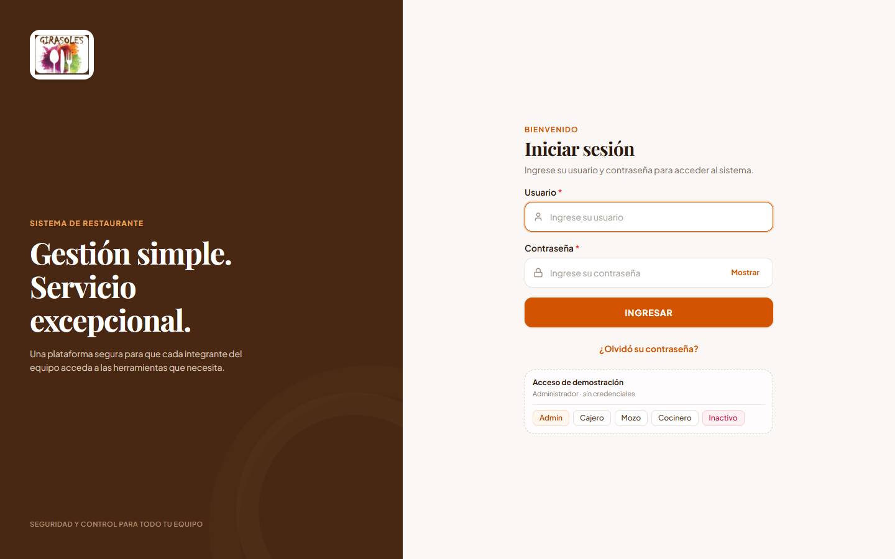
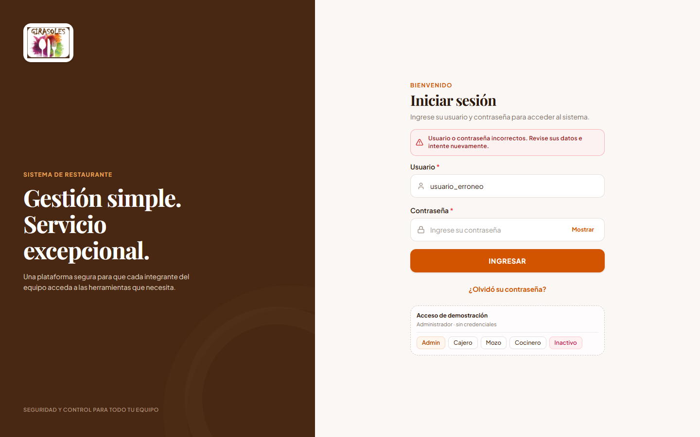
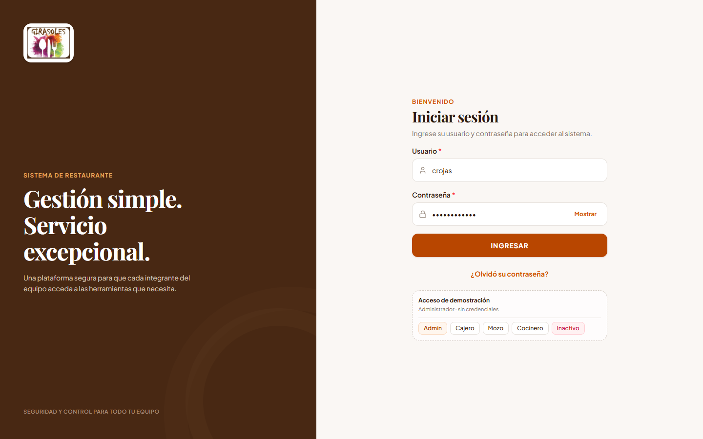
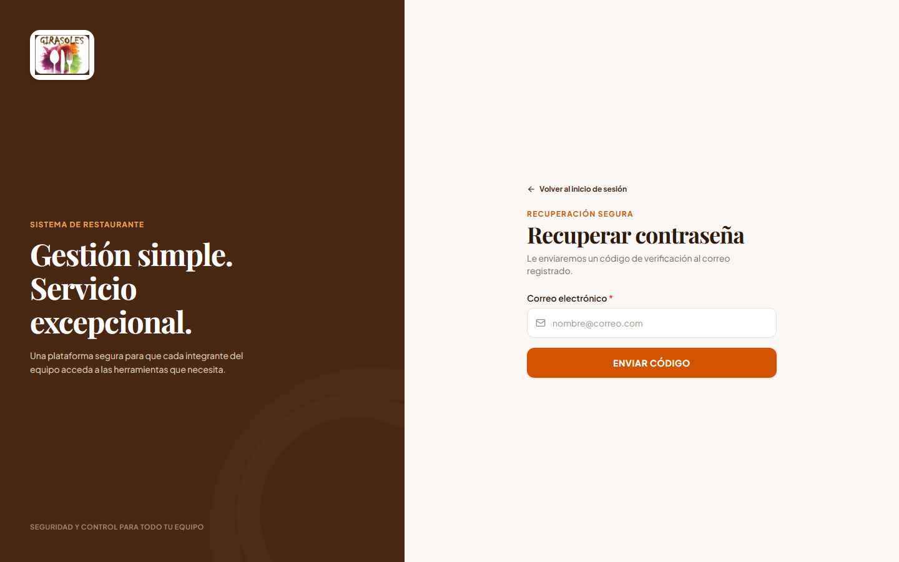
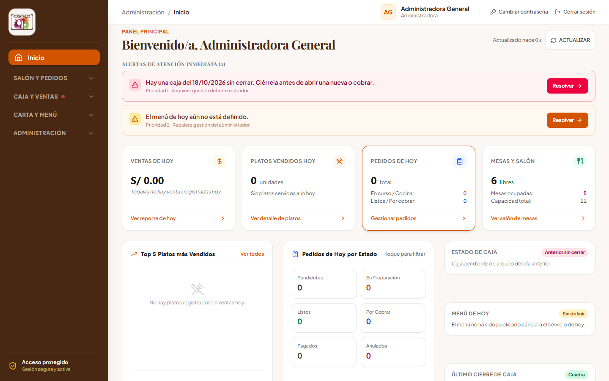
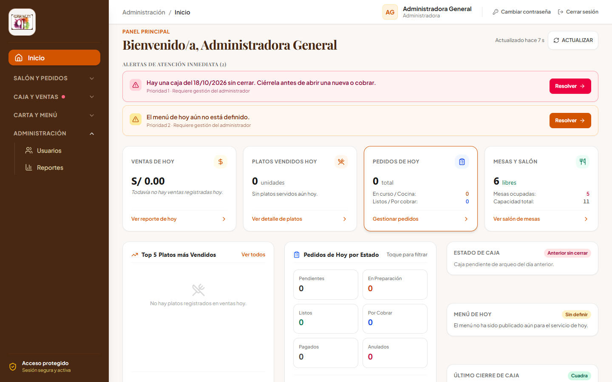
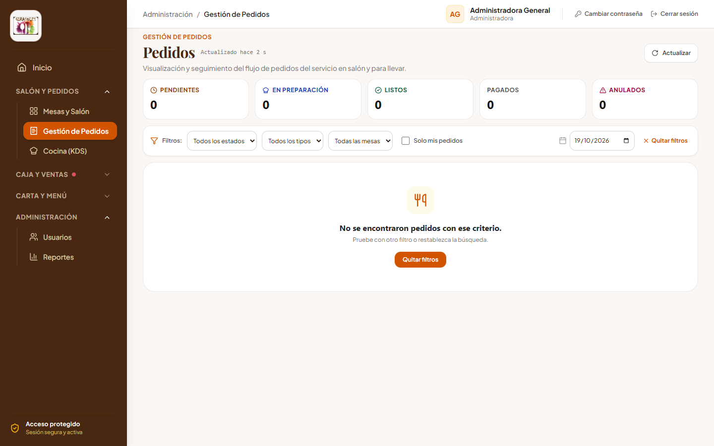
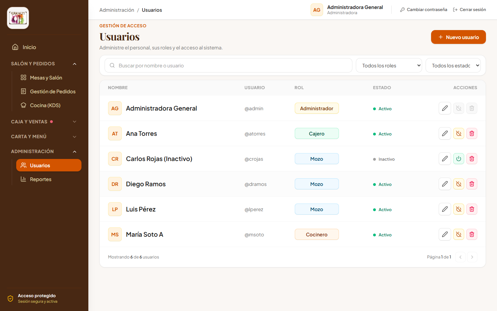
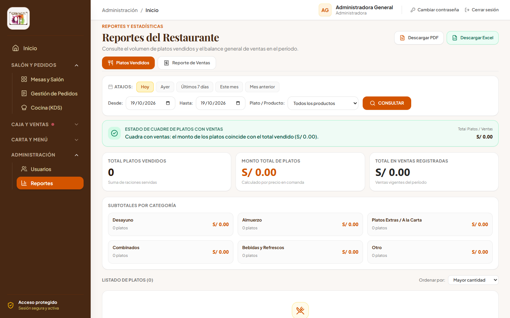

# Manual Visual y Flujos del Sistema - Girasoles Restaurante

Documentación integral con capturas de pantalla de todas las vistas, modales, formularios, validaciones de error y flujos operativos del sistema para **Girasoles Restaurante**.

---

## 1. Módulo de Autenticación y Control de Acceso (CUS-01, CUS-02, CUS-03)

El sistema implementa autenticación basada en tokens JWT con control de acceso basado en roles (RBAC: Administrador, Cajero, Mozo y Cocinero), bloqueo de cuentas inactivas y detección de inactividad a los 28 minutos con aviso previo.

### 1.1 Pantalla Principal de Inicio de Sesión
Formulario de ingreso seguro con campos de usuario, contraseña, botones de acceso rápido para demostración y enlaces de ayuda.

### 1.2 Validación de Credenciales Incorrectas
Manejo de errores cuando las credenciales no coinciden con la base de datos, protegiendo contra enumeración de usuarios y mostrando un mensaje claro.

### 1.3 Bloqueo de Acceso a Usuarios Inactivos
Cuando un usuario ha sido desactivado administrativamente, el sistema deniega el acceso y alerta de forma preventiva.

### 1.4 Recuperación y Restablecimiento de Contraseña
Pantalla para solicitar el restablecimiento de contraseña ante olvido o pérdida de credenciales.

---

## 2. Panel Principal (Dashboard) y Perfil de Usuario

### 2.1 Dashboard General de Operaciones
Vista principal para el rol Administrador. Incluye métricas de ventas del día, pedidos en curso, mesas activas y accesos rápidos a las funciones críticas.

### 2.2 Modal de Cambio de Contraseña
Ventana modal accesible desde el menú de usuario para actualización periódica de la contraseña personal con validación de requisitos de seguridad.

---

## 3. Salón y Gestión de Mesas (CUS-06)

### 3.1 Distribución y Estado de Mesas en Salón
Panel gráfico que refleja el estado en tiempo real de cada mesa (Disponible, Ocupada, Atendida, En Espera). Permite a los mozos y administradores identificar rápidamente la capacidad del local.

### 3.2 Modal de Nueva Mesa / Edición de Mesa
Formulario modal para registrar nuevas mesas en el salón o editar número, capacidad de comensales y ubicación.

---

## 4. Gestión de Pedidos y Comandas (CUS-07, CUS-08)

### 4.1 Monitor General de Pedidos
Listado de todas las órdenes en curso con filtros por estado (Pendiente, En Preparación, Listo, Entregado, Pagado) y tipo de servicio (Mesa o Para Llevar).

### 4.2 Modal para Tomar Pedido en Mesa
Interfaz interactiva que permite a los mozos seleccionar platos de la carta, platos del día, ajustar cantidades y agregar observaciones personalizadas para cocina.

### 4.3 Modal de Configuración de Menú Completo (CUS-07)
Selección guiada de los tres componentes del menú: Entrada, Segundo y Bebida, con validación de stock y aplicación de precio unificado de menú.

### 4.4 Pedidos para Llevar (Takeout / Delivery)
Flujo optimizado para registrar pedidos rápidos para llevar, capturando nombre del cliente y despachando comanda directamente.

---

## 5. Módulo de Cocina (KDS - Kitchen Display System) (CUS-09)

### 5.1 Pantalla KDS en Tiempo Real
Pantalla táctil para cocineros donde las comandas aparecen organizadas por orden de llegada con temporizador visual de alerta (verde, ámbar, rojo) para controlar los tiempos de preparación y despacho.

---

## 6. Módulo de Caja y Cobros (CUS-10, CUS-11, CUS-12, CUS-13)

### 6.1 Panel Principal de Caja y Cobros
Vista general del cajero que muestra el estado operativo del turno de caja, lista de pedidos listos para cobrar y montos acumulados.

### 6.2 Modal de Apertura de Caja con Denominaciones en Soles
Registro obligatorio del saldo inicial en caja mediante el desglose exacto de billetes y monedas en Soles peruanos.

### 6.3 Modal de Cobro - Pestaña Ticket
Cobro en efectivo o billetera digital (Yape/Plin) con cálculo automático de vuelto y generación de comprobante de venta interno.

### 6.4 Modal de Cobro - Pestaña Boleta con Validación RENIEC
Emisión de Boleta de Venta electrónica con consulta automática en línea a RENIEC por número de DNI para obtener apellidos y nombres del cliente.

### 6.5 Modal de Cobro - Pestaña Factura con Validación SUNAT
Emisión de Factura electrónica con consulta automática en línea a SUNAT por número de RUC para obtener la Razón Social, estado del contribuyente y dirección fiscal.

### 6.6 Modal de Cierre de Caja y Arqueo Ciego
Procedimiento de cierre de turno con conteo ciego de efectivo por denominaciones, cálculo automático de diferencias (sobrante/faltante) y generación de resumen de turno.

---

## 7. Gestión de Ventas e Historial Fiscal (CUS-11, CUS-12)

### 7.1 Historial de Ventas y Comprobantes
Listado centralizado de ventas con filtros avanzados por rango de fechas, tipo de comprobante (Ticket, Boleta, Factura) y estado de anulación.

### 7.2 Modal de Detalle de Venta y Desglose Fiscal
Visualización detallada de la venta con desglose de ítems, Operación Gravada, IGV (18%), Total, datos del cliente, datos del comprobante y descarga directa en PDF oficial.

---

## 8. Menú del Día y Catálogo de Productos (CUS-04, CUS-05)

### 8.1 Planificación del Menú del Día
Gestión diaria para seleccionar qué entradas, segundos y bebidas estarán disponibles para el público, definiendo precios de menú y límites de stock.

### 8.2 Catálogo General de Productos
Listado maestro de productos, componentes, platos a la carta y bebidas con categoría, precio y estado de disponibilidad.

### 8.3 Modal de Nuevo / Edición de Producto
Formulario para registrar nuevos platos o componentes en el catálogo maestro.

---

## 9. Administración de Usuarios y Seguridad (CUS-01, CUS-02)

### 9.1 Directorio de Usuarios del Sistema
Lista de colaboradores con información de usuario, nombres, correo, rol asignado (Admin, Cajero, Mozo, Cocinero) y estado activo/inactivo.

### 9.2 Modal de Creación y Edición de Usuario
Formulario seguro para dar de alta a nuevos empleados con asignación de rol y credenciales temporales.

---

## 10. Auditoría y Reportes Gerenciales (CUS-14, CUS-15)

### 10.1 Historial de Cierres de Turno
Auditoría completa de todas las sesiones de caja anteriores con montos de apertura, ventas en efectivo y billeteras digitales, y diferencias registradas.

### 10.2 Dashboard de Reportes y Estadísticas
Gráficos interactivos de ingresos por período, comparación de formas de pago, platos más vendidos y exportación de reportes ejecutivos.

---
*Documento generado automáticamente por Antigravity para el equipo de desarrollo de Girasoles Restaurante.*
