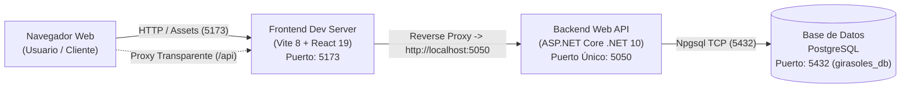

# 🚀 Stack Tecnológico Oficial y Arquitectura de Ejecución

> [!IMPORTANT]
> **ESTÁNDAR VINCULANTE PARA EL EQUIPO DE DESARROLLO:**
> Todo el sistema "Restaurante Girasoles" opera bajo un stack unificado y estandarizado. Queda estrictamente prohibido introducir frameworks no autorizados, bindings a puertos secundarios obsoletos (`5000`) o versiones desalineadas de compilador.

---

## 📑 1. Matriz Canónica del Stack Tecnológico

| Capa / Subsistema | Tecnología / Herramienta | Versión Oficial | Puerto / Endpoint de Ejecución |
| :--- | :--- | :--- | :--- |
| **Backend REST API** | .NET (C#) / ASP.NET Core Web API | `net10.0` (SDK 10.0.400) | `http://localhost:5050` |
| **Documentación Swagger** | Swashbuckle OpenAPI v1 | `6.6.2` | `http://localhost:5050/swagger` |
| **Frontend Web** | React + TypeScript + Vite | React `19.2.8` / TS `~6.0.2` / Vite `^8.3.0` | `http://localhost:5173` |
| **Motor de Estilos UI** | Tailwind CSS v4 | `^4.3.3` (`@tailwindcss/vite`) | Compilador nativo en Vite |
| **Runtime JS/TS** | Node.js | `v24.21.0` | CLI / Servidor de Desarrollo |
| **Linter de Código Frontend** | Oxlint | `^1.81.0` | CLI / Pipeline de Calidad |
| **Base de Datos Relacional** | PostgreSQL | `v16+` / `v17+` | `localhost:5432` (`girasoles_db`) |
| **ORM / Acceso a Datos** | Entity Framework Core + Npgsql | `9.0.2` / `9.0.0` (LTS wave) | Conexión pooling vía DbContext |
| **Suite de Pruebas** | xUnit + Moq + EF Core InMemory | xUnit `2.9.2` / Moq `4.20.72` | 57 Pruebas Unitarias (`net10.0`) |

---

## 🌐 2. Topología de Red y Enlace de Puertos



### Reglas de Networking:
1. **Puerto Único Backend (5050):**
   - Configurado en `backend/GirasolesRes.API/Properties/launchSettings.json`.
   - Se eliminó de raíz el puerto `5000` para evitar colisiones con servicios nativos del sistema operativo (como AirPlay en macOS o servicios IIS/Docker predeterminados).
2. **Proxy Transparente en Frontend (5173 -> 5050):**
   - Configurado en `frontend/vite.config.ts`: toda petición con prefijo `/api` es enrutada internamente hacia `http://localhost:5050`.
   - **Beneficio:** Evita problemas de CORS en desarrollo y simplifica el consumo en los servicios cliente sin hardcodear URLs absolutas.

---

## 🧪 3. Estrategia de Pruebas y Calidad de Código

- **Framework de Testing:** xUnit `2.9.2` unificado sobre `net10.0`.
- **Aislamiento de Persistencia:** Las pruebas de integración en memoria utilizan `Microsoft.EntityFrameworkCore.InMemory` versión `9.0.0`.
- **Mocking:** `Moq` `4.20.72` para aislamiento estricto de repositorios y servicios externos.
- **Cobertura:** Suite completa de 57 pruebas automatizadas cubriendo los casos de uso principales (Seguridad, Usuarios, Productos, Menú del Día, Mesas, Comandas, Pedidos, Caja y Facturación).

---

## 📋 4. Comandos de Operación para el Equipo

### Compilación y Ejecución del Backend
```bash
# Compilación limpia
dotnet build backend/GirasolesRes.API/GirasolesRes.API.csproj -c Debug

# Ejecución en puerto único oficial
dotnet run --project backend/GirasolesRes.API/GirasolesRes.API.csproj --urls "http://localhost:5050"
```

### Ejecución de Pruebas Unitarias
```bash
dotnet test tests/GirasolesRes.Tests/GirasolesRes.Tests.csproj
```

### Ejecución y Compilación del Frontend
```bash
# Entorno de desarrollo
cd frontend
npm run dev

# Verificación de compilación de tipos y bundle
npm run build

# Análisis estático y linter
npm run lint
```

---

## 🔗 Enlaces Relacionados en la Base de Conocimiento
- [[DIRECTRIZ_PERMANENTE_ARQUITECTURA]]
- [[DESIGN_SYSTEM]]
- [[MANUAL_ESTANDARES_UI_UX]]
